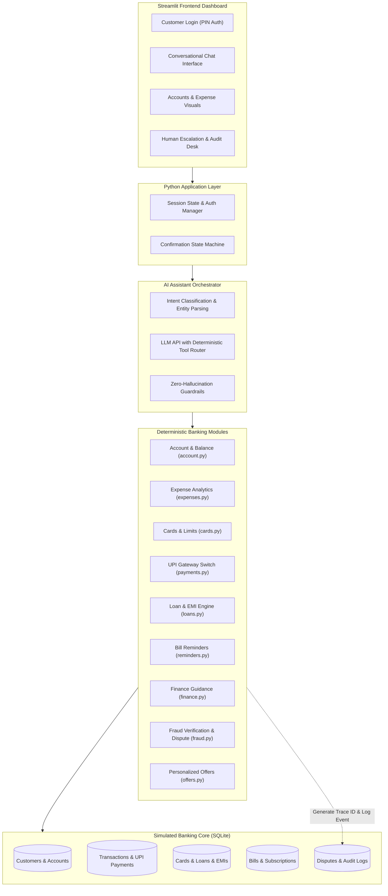
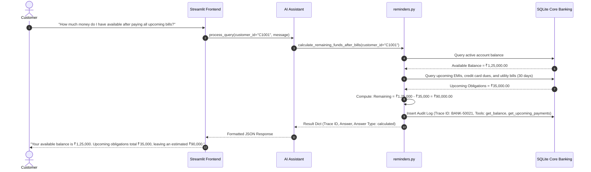

# Architecture & System Design Document

## AI-Powered Daily Banking Assistant
**HCLTech Future Ready AI Engineer Hackathon**

---

## 1. System Architecture Overview

The application follows a clean, layered, modular Python architecture designed for high maintainability, strict auditability, zero financial hallucinations, and responsive user interaction.

---

## 2. Component Responsibilities

### 2.1 Frontend Layer (`app.py`)
- **Technology:** Streamlit, Plotly, Pandas.
- **Responsibilities:**
  - Renders the corporate banking dashboard with HCLTech blue theme.
  - Multi-customer demo switcher and PIN authentication.
  - Interactive chat interface with Suggested Prompts, Trace ID badges, and tool call indicators.
  - High-resolution data visualizations (category donut chart, monthly spend trend bar chart).
  - Dedicated "Human Oversight & Audit Desk" tab for bank officers to inspect escalated tickets and review audit logs.

### 2.2 Orchestration & AI Layer (`ai/assistant.py`, `ai/prompts.py`)
- **Core Principle:**
  *"Use deterministic banking tools for balances, calculations, eligibility and actions. Use the language model for conversation, explanation and orchestration, with policy controls and human approval for high-risk decisions."*
- **Responsibilities:**
  - Receives natural language prompts from customers.
  - Manages sensitive confirmation flows (`pending_action` state machine).
  - Maps requests directly to deterministic Python functions.
  - Never invents financial data; returns clear `NOT_FOUND` messages when records do not exist.
  - Formats responses with Trace IDs (e.g. `BANK-50021`) and tool metadata matching the hackathon PDF specification.

### 2.3 Banking Services Layer (`banking/*.py`)
- **Deterministic Math & Rules:** Every calculation (balance sum, upcoming deductions, EMI amortization split, savings rate, FOIR limits) is executed by pure Python code with standard decimal arithmetic.
- **Isolated Modules:**
  - `account.py`: Real-time balances and transaction history.
  - `expenses.py`: Aggregations by category and monthly trends.
  - `cards.py`: Credit card statements, repayment tiers, card blocking, and credit limit revision.
  - `payments.py`: UPI status lookups, UTR tracking, and NPCI failure explanations.
  - `loans.py`: Amortized schedules, next EMI countdown, and principal/interest breakdown.
  - `finance.py`: Non-binding financial health observations and discretionary spend analysis.
  - `reminders.py`: Multi-source upcoming obligation rollup and deterministic remaining funds calculation.
  - `fraud.py`: Heuristic fraud verification, suspicious transaction flagging, and dispute workflow creation.
  - `offers.py`: Policy-based loan and deposit pre-approval engine.

### 2.4 Data & Persistence Layer (`database/db.py`, `schema.sql`, `sample_data.py`)
- **Technology:** SQLite with parameterized queries (`?` place-holders) to eliminate SQL injection vulnerabilities.
- **Simulated Real-Time Structure:** Tables represent core banking subsystems:
  - Core Banking (`customers`, `accounts`, `transactions`)
  - Card Platform (`credit_cards`)
  - UPI Switch (`upi_payments`)
  - Loan Management (`loans`, `emi_schedules`)
  - Bill Aggregator (`bills_subscriptions`)
  - Fraud & Risk (`disputes`)
  - CRM (`personalized_offers`)
  - Compliance (`audit_logs`)

---

## 3. Data Flow: Example Calculation Workflow

Matching Section 7 of the problem statement (*"How much money do I have available after paying all upcoming bills?"*):

---

## 4. Security & Compliance Controls

1. **R1 - Secure Authentication & Session Isolation:**
   - 4-digit PIN verified via SHA-256 hash.
   - All SQL queries require `WHERE customer_id = ?`, preventing cross-customer data leakage.
2. **R4 - Customer Confirmation for Sensitive Actions:**
   - Actions like permanent card blocking, credit limit changes, and payment transfers require explicit confirmation before execution.
3. **R6 - Anti-Hallucination Guardrails:**
   - Strict separation between natural language formatting and data generation.
   - Non-existent merchants or transaction IDs return explicit `"NOT_FOUND"` outcomes.
4. **R7 - Human Oversight:**
   - Suspicious transactions flagged with risk heuristics automatically trigger ticket creation assigned to an authorized bank fraud officer.
   - Officers can review, approve, or reject cases in the dedicated dashboard tab.
5. **R8 - Comprehensive Auditability:**
   - Every user interaction generates an enterprise Trace ID (e.g. `BANK-50021`).
   - Timestamps, systems queried, tools invoked, input parameters, and decisions are logged immutably.

